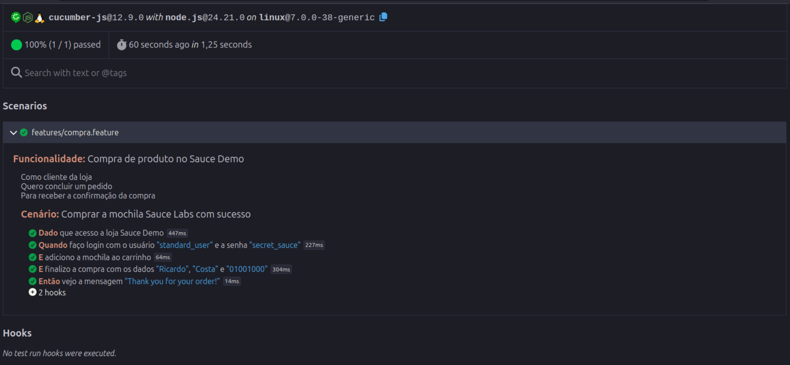

# sd-playwright-cucumber

Testes E2E do [Sauce Demo](https://www.saucedemo.com/) com Playwright e Cucumber, em JavaScript.

## Pastas

| Pasta | Responsabilidade |
| --- | --- |
| `pages` | Elementos da tela e ações de UI (preencher, clicar, ler texto) |
| `interactions` | Intenções do usuário, compostas pelas pages |
| `tests` | Fluxo E2E e a verificação do resultado de negócio |
| `features` | Cenários em Gherkin |
| `steps` | Liga cada frase do cenário à classe de teste |
| `support` | Browser, hooks e configuração |

O caminho de um cenário é: `features` → `steps` → `tests` → `interactions` → `pages`.

## Como rodar

```bash
npm install
npm install --save-dev @cucumber/cucumber
npx playwright install
npm test
```

Para ver o browser:

```bash
npm run test:headed
```

O relatório HTML fica em `reports/cucumber-report.html`.


